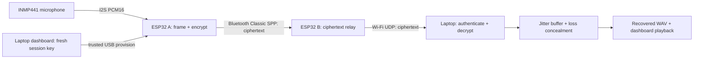

# CAALC-128: project evaluation notes

**Design and Implementation of a Lightweight Cellular Automata-Based Authenticated Cipher for Post-Quantum-Oriented Secure IoT Audio Communication**

Department of Computer Science and Engineering, NIT Patna. Source presentation team: Saniya (2306139), Debajit Das (2306151), Ruchi Raj (2306140); guide: Dr. Bhaskar Mondal. These details come from the uploaded presentation, not inferred profile information.

## Abstract

This project implements and evaluates CAALC-128, an experimental authenticated-encryption construction for framed IoT audio. A 384-bit, 24-round Feistel permutation uses a CA-inspired word-oriented nonlinear function based on XOR, AND, NOT and rotation. A fully specified keyed duplex mode handles associated metadata, ciphertext and 128-bit tags. Python and portable C++ implementations are cross-checked, while audio integrity is evaluated through exact sample reconstruction, MSE, PSNR and SNR. Standardized ML-KEM-512 and HKDF demonstrate post-quantum-resistant shared-secret establishment at the software layer. The Ascon authors' final-standard implementation supplies a reproducible reference baseline. The revised physical demonstration uses an INMP441 on ESP32 A, Bluetooth Classic SPP to ESP32 B, Wi-Fi UDP from B to the laptop, and laptop-side authenticated recovery and playback. Executed host experiments demonstrate functional correctness for the tested cases; neither those results nor the use of cellular automata prove cryptographic security. Physical microphone, Wi-Fi and device timing results must be obtained separately.

## Problem statement and objectives

IoT audio packets need confidentiality and modification detection across capture and network relays. This design uses separate ESP32 sender and relay boards, while keeping the traffic key and plaintext recovery on the laptop. A useful undergraduate research contribution should specify its mathematics precisely and distinguish implementation success from unproven security claims.

The objectives are to define one reproducible custom permutation and AEAD mode; verify independent Python/C++ agreement; preserve PCM exactly when all authenticated packets arrive; investigate diffusion, differential samples and simple structural patterns; demonstrate ML-KEM traffic-key derivation; compare against standardized Ascon under a common native-code methodology; and prepare a physical two-board Bluetooth/Wi-Fi demonstration. The earlier ₹500 one-board budget assumption must be re-estimated for the revised hardware.

## Research gap and nature of contribution

The engineering research question is whether this particular CA-inspired Feistel/duplex candidate can support a reproducible, explainable audio prototype with modest implementation resources. The contribution is the **selected function, constants, duplex specification, packet integration and evaluation package**. Feistel networks, cellular automata, sponge/duplex constructions, HKDF and ML-KEM are existing concepts. No claim is made that this is the first CA-based cipher, that Ascon lacks features, or that novelty by itself implies security. Establishing publication-level novelty would require a broader systematic literature review and independent cryptanalysis.

Earlier image-encryption references are historical; the current demonstrator captures and protects microphone audio. Background literature is not used to assert unverified superiority or novelty. Primary standards and implementation sources are listed in README.

## Reconciliation with the mid-evaluation material

| Earlier material | Implemented final direction | Reason |
|---|---|---|
| 128-bit internal state | 384-bit state, 128-bit key/rate/tag/nonce | User's final mathematical specification |
| Generic NL/CA/diffusion/key schedule | Explicit 24-round Feistel permutation and keyed duplex | Reproducibility and correctness |
| Reversible CA core terminology | Nonreversible F inside reversible Feistel | Invertibility follows from Feistel, not a false claim about F |
| Two ESP32 nodes, ESP-NOW, MAX98357A | Two ESP32 DevKit V1 boards, Bluetooth SPP + Wi-Fi UDP, laptop playback | Updated professor topology; output moved to laptop |
| Quantum-secure title | Post-quantum-oriented, ML-KEM component | Avoid claiming experimental symmetric security |
| 128-bit framing diagram | 128-bit duplex rate inside 160–1280-byte audio frames | Distinguishes cipher blocks from audio frames |

The handwritten note requests lightweight cryptographic computation/AEAD, PSNR, a nonlinear-feedback/CA direction, quantum security and audio. The final user instruction chooses CA rather than an additional unrelated NLFSR cipher. PSNR is included with mathematically correct limitations.

## Mathematical construction and explanations

The state is S=(L,R), each half containing six 32-bit words. Each round maps `(L,R)` to `(R,L XOR F(R) XOR C_r)`. Knowing the output gives the old R directly; XORing the second output with F of that known value and the same constant gives the old L. This constructive inverse proves a permutation regardless of whether F is reversible.

F uses neighbors i−1,i,i+1,i+2 under periodic indexing. Rotations create bit-position dependencies while the product `ROTL(R_(i−1),7) AND NOT ROTL(R_(i+1),13)` supplies nonlinear Boolean interaction. XOR combines local and neighbor contributions. This is word-oriented CA inspiration, not a conventional elementary one-dimensional binary CA rule number. `docs/SPECIFICATION.md` gives the full equations, constant derivation, forward/inverse definitions and encryption/decryption pseudocode.

The duplex rate is 16 bytes. The remaining 32 bytes are capacity. Key and nonce initialization, distinct AD/message/finalization domains, mandatory padding and explicit lengths define the mode. Ciphertext replacement allows sender and receiver to reach identical states. Authentication checks complete before plaintext release. Mode validity is a research hypothesis; no sponge theorem is invoked to certify this candidate.

A separate round-key schedule is not required by this selected public-permutation design. Secret key material is injected at initialization and finalization; round constants are public. Calling constants “round keys” would be incorrect.

## System architecture

The optional ML-KEM/ML-DSA session exchange remains a separate laptop-only software demonstration; the live hardware dashboard provisions a fresh traffic key over trusted USB.

Software framing supports mono signed PCM16 at 8/16 kHz and 10/20/40 ms. The physical sender's initial configuration is 8 kHz/20 ms. A 320-byte default payload receives a 28-byte authenticated header and 16-byte tag. Sequence and session ID form a 16-byte nonce. File containers additionally authenticate total length and enforce contiguous frame order.

## Post-quantum key-establishment component

NIST FIPS 203 specifies ML-KEM. This project uses the external `pqcrypto` library's ML-KEM-512 implementation, not custom lattice code. One logical endpoint generates a public/private key pair; the sender encapsulates to that public key; the receiver decapsulates with its private key. HKDF-SHA256 derives a purpose-specific 16-byte key from the matching shared secret with a transcript-dependent salt and explicit traffic direction.

The software test verifies shared-secret and derived-key equality and then uses both keys in a CAALC encryption/decryption round trip. ML-KEM does not authenticate the owner of the public key. Both endpoints run in one process here; there is no identity-bound remote handshake. Provisioning the traffic key over controlled USB demonstrates the session boundary without asking the ESP32 to execute ML-KEM. It does not turn an unauthenticated setup or an experimental symmetric cipher into a proven end-to-end PQ system.

### Authenticated session extension

The current source additionally includes `pq_session.py`, an academic two-role handshake demonstration. The responder creates an ephemeral ML-KEM-512 keypair and signs the suite, both pinned identities, a random challenge and its KEM public key with ML-DSA-44. The initiator verifies the responder fingerprint and signature, encapsulates a shared secret, signs the complete exchange transcript and returns the ciphertext. The responder verifies the initiator's pinned identity and signature, decapsulates and derives the same context. HKDF-SHA256 produces independent CAALC, Ascon and confirmation keys plus an 8-byte session ID. The initiator checks an HMAC confirmation before accepting the session.

This verifies protocol data flow locally in one process; it is not a network service or a reviewed secure-channel implementation. An explicit output option saves the selected key and matching session ID in an owner-only demo file for trusted USB provisioning. The post-quantum demonstration authenticates public keys only when their fingerprints have been pinned out of band; the demo's logical roles are created and pinned in the same process.

## Hardware architecture and feasibility

The revised physical setup requires two original ESP32 DevKit V1 boards, one INMP441 and a laptop. ESP32 A captures/encrypts; ESP32 B forwards ciphertext; the laptop authenticates, decrypts and plays it. The previous ₹500 one-board estimate no longer applies and must be checked against local purchase prices. Firmware uses 32-bit integer operations and fixed audio/packet buffers. Wi-Fi and I2S SDK memory are separate from the cipher's work buffers. Feasibility must be demonstrated by actual purchasing and hardware testing; allocation caps in HARDWARE.md are not vendor price quotes.

## Experimental methodology

Functional verification uses deterministic vectors and seeded random states, inverse checks, empty/partial/full blocks, maximum API size, audio format combinations, malformed lengths and authentication failures. Native C++ and Python outputs are compared byte-for-byte. Replay state updates occur after authentication. UDP loopback tests exercise the real receiver without ESP32 hardware.

Audio quality uses float64 accumulation after decoding signed PCM16, avoiding 16-bit subtraction overflow. MSE is mean squared sample error. PSNR uses a fixed signed-PCM peak magnitude of 32768. SNR uses original signal energy divided by error energy. Exact reconstruction has zero error and infinite PSNR; SNR is also assigned +∞ for exact recovery, including silence. Silence with nonzero error produces −∞ SNR. Empty or unequal-length arrays are rejected. Perfect values prove lossless recovery in that test, not confidentiality.

Loss simulation injects seeded packet removal and bounded arrival jitter. Authenticated frames enter a deadline queue; missing frames become silence. This changes recovery quality even if every accepted frame is cryptographically correct. Simulation is not a Wi-Fi measurement.

## Security-analysis methodology

Evidence is separated into four categories:

1. **Functional correctness:** inverse identities, byte agreement, recovery and rejection tests.
2. **Statistical properties:** avalanche, key sensitivity, empirical byte entropy, round-wise diffusion.
3. **Cryptanalytic evidence:** limited searches for simple fixed/repeated-word behavior and rotation equivalence; no comprehensive attack analysis.
4. **Hardware performance:** only obtainable on the physical target; host tests do not substitute for it.

A flip changes one randomly selected input bit in a random 384-bit state. The output Hamming distance is measured over 384 bits. Key sensitivity flips one key bit and compares 320-byte ciphertexts. Round-wise measurements illustrate slow early Feistel propagation. Difference collisions in sampled pairs are recorded but do not estimate the maximum differential probability. Zero, all-one, alternating-bit and repeated-one-word states are included in simple structural checks.

Raw F has rotation and cyclic-word equivariance; constants are necessary to break those exact symmetries in the complete permutation. No implication is made that this eliminates rotational attacks. Independent review should assess differential characteristics, linear approximations, algebraic degree growth, invariant subspaces, related-key behavior, mode-level forgery attacks, nonce misuse and fault/side-channel leakage.

## Ascon comparison methodology

The package vendors the authors' `asconaead128/ref` source from a recorded commit and verifies all 1,089 supplied final-standard known-answer cases. It does not substitute older Ascon-128 or Ascon-128a submission code. Both comparison implementations are compiled as native libraries with `-O2` and called through the same ctypes adapter. Encryption/decryption use the same payload lengths, public test keys, headers and trial counts, with five warmups. Timings include FFI overhead and host scheduling. Median and 95th-percentile times and throughput are reported, with raw samples.

The benchmark is implementation-level evidence on a shared x86-64 host. Reference Ascon is not necessarily its most optimized variant. Native object text sizes and compiler stack records are reported separately from process memory, total firmware flash, SDK RAM or power consumption. The supplied optional sketch compares the two implementations on one ESP32; results remain empty until run on the actual device.

## Results and discussion

See `../results/RESULTS.md` for automatically assembled measured tables and `../results/VERIFICATION.md` for executed test status. The host tests observed exact audio reconstruction. Ascon was faster than CAALC in the measured frame comparisons; therefore this experiment does not support a speed advantage for the custom construction. The measured object-size comparison is narrower than an embedded flash claim. Statistical scores near expected random values do not validate the cipher's security.

## Limitations and future work

CAALC has no independent cryptanalysis or proof. Its 128-bit key length must not be described as guaranteed 128-bit security, especially in a quantum threat model. The authenticated handshake is a local software demonstration; the ESP32 has no remote identity verification or live PQ handshake. No claim is made about microphone sound quality, RF reliability, physical latency, energy consumption or hardware timing until tested. The compact firmware config parser excludes whitespace-containing Wi-Fi credentials. Session replay state is in memory; new sessions/keys are required after restarts. Whole-file WAV operations keep data in laptop memory. Python processing timing differs substantially from native C++ and may limit real-time workloads.

Future work should prioritize independent differential/linear and mode cryptanalysis, authenticated transcript binding, persistent anti-replay/key lifecycle design, real ESP32 profiling, microphone calibration, jitter/loss improvements and compiler-specific constant-time evaluation. Reducing rounds purely to improve a benchmark is not justified by this package.

## Final presentation outline (16 slides)

1. Title, team, guide; explicitly say experimental.
2. IoT audio problem and the two-board Bluetooth/Wi-Fi architecture.
3. Prior work and honest research question.
4. Final architecture and differences from mid-evaluation.
5. Parameters: state, halves, rounds, rate, capacity, key/nonce/tag.
6. CA-inspired F with neighbor and rotation explanation.
7. Feistel forward/inverse derivation.
8. Full duplex AEAD, domains, padding, tag and length binding.
9. Packet layout, nonce lifecycle and replay handling.
10. ML-KEM + HKDF demonstration and authentication boundary.
11. Python/C++ correctness, Ascon KAT and tampering results.
12. Audio waveform/spectrogram, MSE/PSNR/SNR and loss simulation.
13. Statistical screening and what it cannot prove.
14. Native CAALC/Ascon measured comparison; show Ascon's advantages.
15. Physical wiring, USB fallback, actual hardware status.
16. Limitations, next experiments and conclusion.

## Likely viva questions and suggested answers

**What is new?** The specific CA-inspired F, constant schedule, experimental duplex integration and evaluated audio system; not Feistel networks, CA, HKDF or ML-KEM themselves.

**Why is it invertible?** The next left half reveals the old right half, allowing the old left half to be recovered by XOR. F does not need an inverse.

**Why 24 rounds?** It is the selected experimental parameter. Observed diffusion motivates testing it, but does not establish an adequate security margin.

**Is it exactly cellular automata?** It is a word-oriented nonlinear transformation inspired by periodic local CA neighborhoods, not a conventional elementary CA rule.

**Does cellular automata mean secure?** No. Security requires attack analysis of the exact construction and mode.

**Why a 384-bit state?** The chosen duplex layout assigns 128 bits to rate and 256 bits to capacity. Those sizes do not prove a security level for this custom permutation.

**Where is the key schedule?** This is a public-permutation keyed mode: the key enters initialization/finalization. Public round constants are not a key schedule.

**What does authentication protect?** Ciphertext and associated header fields; file mode also binds total length and framing. It cannot prevent loss or denial of service.

**What if a nonce repeats?** The required operating condition is violated; security may fail. Fresh session keys and monotonic sequence numbers are mandatory.

**Why does decryption not call the inverse permutation?** Duplex decryption reconstructs the forward state by absorbing ciphertext and XORing the same rate bytes. The inverse is a separate correctness test.

**Is this quantum secure?** ML-KEM provides a standardized PQ-oriented shared-secret component, and the local handshake demo uses ML-DSA signatures for identity binding. Neither the experimental CAALC cipher nor the local-to-hardware workflow has a proven end-to-end PQ security claim.

**Why not encrypt all audio with ML-KEM?** ML-KEM encapsulates a shared secret; the derived symmetric traffic key handles audio efficiently.

**Does ML-KEM authenticate the sender?** No. Public-key identity and transcript authentication need a separate protocol mechanism.

**Why infinite PSNR?** Error energy is zero after exact recovery; the limiting PSNR is +∞. It says nothing about whether the ciphertext is hard to attack.

**Why use 32768 rather than the observed peak?** It is the fixed peak magnitude of signed PCM16. This convention makes comparisons independent of a particular clip's loudness.

**Is high entropy a security proof?** No. Simple insecure transformations can also produce apparently random output.

**Was CAALC faster than Ascon?** Not in the supplied host benchmark. The actual tables must be shown rather than a desired result.

**How is comparison fair?** Both are portable native builds under the same compiler optimization and FFI timing path; remaining limitations such as host scheduling and implementation choice are disclosed.

**What hardware results are available?** Only those explicitly marked executed in VERIFICATION.md. Compilation, when available, is not flashing or physical testing.

**How does the revised hardware affect budget?** The professor-facing demonstration now needs two ESP32 DevKit V1 boards plus an INMP441. Recheck local prices; the earlier one-board ₹500 estimate no longer establishes that the two-board setup fits.
