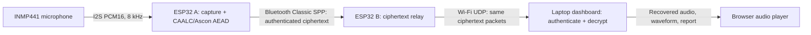

# Two-ESP32 live audio demonstration

## Final data path

The hardware demonstration uses two original ESP32 DevKit V1 boards and the laptop:



ESP32 B is a relay and never receives the traffic key. Audio stays encrypted from ESP32 A through both radio links and is decrypted on the laptop only after authentication succeeds. The dashboard creates a fresh key and session ID per run, provisions the key to ESP32 A over trusted USB, and keeps its copy in memory. The session key is not saved to disk.

Use **ESP32 DevKit V1 with the original ESP32/WROOM-32 chip** for both boards. Bluetooth Classic SPP is required; ESP32-S2, S3 and C3 boards do not support this firmware's BluetoothSerial transport. ESP32 Wi-Fi and Bluetooth share the same radio path and take turns transmitting/receiving, so measure loss and latency on the actual boards and local Wi-Fi. This project has not been physically validated until you complete the acceptance procedure below.

## Parts and wiring

Required:

- 2 × ESP32 DevKit V1 boards with USB data cables.
- 1 × INMP441 I2S microphone module and jumper wires.
- Laptop running the project dashboard.
- A 2.4 GHz Wi-Fi network shared by ESP32 B and the laptop.

Wire the microphone to **ESP32 A only**. Disconnect power before wiring. Use 3.3 V; never connect the microphone to 5 V.

| INMP441 | ESP32 A DevKit V1 |
|---|---|
| VDD / VCC | 3V3 |
| GND | GND |
| SCK / BCLK | GPIO14 |
| WS / LRCL | GPIO15 |
| SD / DOUT | GPIO32 |
| L/R | GND (left channel) |

ESP32 B needs no microphone, DAC, amplifier or speaker. The laptop dashboard is the audio output. Each board stays connected to the laptop by USB so the dashboard can provision it and collect status.

The INMP441 provides signed 24-bit samples in 32-bit I2S slots. ESP32 A reads both slots and automatically selects the one with microphone activity; this avoids the classic ESP32 driver/channel-mapping problem where a mono `ONLY_LEFT` read can return the unused slot. The sender removes DC drift, applies bounded gain and converts the active channel to mono PCM16 at 8 kHz in 40 ms frames (640 audio bytes plus the authenticated header and tag). The 40 ms framing halves radio packet frequency while staying below the Wi-Fi MTU. The dashboard preserves a raw authenticated WAV and creates a separate conditioned playback WAV after tag verification.

## Prepare and flash both boards in VS Code PlatformIO

1. In VS Code, open the project folder `Documents/deb` and close all Serial Monitor windows.
2. In the project terminal, run `python prepare_bluetooth.py` to assemble the two PlatformIO sketches.
3. Open `firmware/esp32_wifi_relay` as a PlatformIO project, select **ESP32 Dev Module**, build, then upload it to ESP32 B. The nested `platformio.ini` pins Espressif32 7.0.1 / Arduino-ESP32 2.0.17.
4. Open `firmware/esp32_bt_sender` as a PlatformIO project, select **ESP32 Dev Module**, build, then upload it to ESP32 A.
5. Leave both boards connected to USB. Close their serial monitors so the dashboard can open both ports. The USB console uses 115200 baud.

The equivalent CLI commands, when the PlatformIO CLI is available in PATH, are:

```bash
python prepare_bluetooth.py
pio run -d firmware/esp32_wifi_relay
pio run -d firmware/esp32_wifi_relay -t upload --upload-port /dev/cu.usbserial-B
pio run -d firmware/esp32_bt_sender
pio run -d firmware/esp32_bt_sender -t upload --upload-port /dev/cu.usbserial-A
```

Replace the two macOS port names with the actual distinct ports. On Windows use `COMx`; on Linux use `/dev/ttyUSBx`. If upload stays on “Connecting…”, hold the board's BOOT button until it starts writing, then release. The root `platformio.ini` remains for the earlier one-board diagnostic firmware; use the nested project folders for this two-board demo.

## Run the laptop dashboard

From the project folder with the virtual environment active:

```bash
python -m streamlit run hardware_dashboard.py
```

The dashboard lists connected serial ports. Choose the sender port for ESP32 A and relay port for ESP32 B, enter the 2.4 GHz Wi-Fi name/password and laptop Wi-Fi IPv4 address, select CAALC or standardized Ascon-AEAD128, then start a 5–60 second capture. The dashboard binds UDP before configuring ESP32 B, reads B's Bluetooth MAC, provisions A, verifies the frames, and stops the sender at the end. Do not leave VS Code Serial Monitor open on either port.

For a terminal-only capture (with the password entered through a hidden prompt), close the dashboard and both PlatformIO Serial Monitors, then run:

```bash
cd /Users/yuvrajmehta/Documents/deb
source .venv/bin/activate
python hardware_capture_cli.py --ssid "YOUR 2.4 GHZ WI-FI" --laptop-ip YOUR_LAPTOP_IP --seconds 15
```

The command prints both provisioning stages and live authentication counters. It writes the authenticated result to `results/live_received.wav` and the complete run report to `results/live_received.wav.json`.

The browser shows pipeline stage status, authenticated/rejected frames, missing audio, a waveform and spectrogram, audio playback, audio-level measurements, a local tamper self-test, relay network counters and a JSON session report. Download the recovered WAV and per-run report. Successful run reports are also kept in `results/hardware_runs.json`, with CSV/JSON export and CAALC-versus-Ascon summaries. Packet-loss percentage is shown only when the sender frame counter is available from the latest sender firmware; older firmware displays “not measured.” The traffic key is not saved. Start a fresh capture after either board reboots. Expand Developer diagnostics for raw counters and serial logs.

If the dashboard reports no authenticated packets, confirm that ESP32 B and the laptop are on the same non-guest 2.4 GHz network, recheck the laptop's Wi-Fi IP, and allow inbound UDP on the selected port in the laptop firewall. Keep both USB cables connected and close serial monitors. Starting another capture resets both boards and provisions a new session.

## Acceptance checklist

Record each item as passed only after observing it on the physical setup:

- Both PlatformIO builds complete for ESP32 DevKit V1.
- Both boards upload and stay online over USB.
- Dashboard reports ESP32 B ready with a local Wi-Fi IP and Bluetooth MAC.
- ESP32 A connects over Bluetooth Classic and streams microphone frames.
- ESP32 A logs `MIC_CHANNEL_DETECT`, then `I2S_READY ... active_slot=N`; its periodic `STAT` line must show nonzero `mic_peak`/`mic_rms` and `i2s_errors=0` while speaking.
- Dashboard receives packets over Wi-Fi and reports authenticated frames.
- Speak into the INMP441 and play the recovered WAV from the dashboard.
- Run CAALC and Ascon separately; each capture creates a fresh key/session.
- Record the boards, Arduino core/build memory, duration, accepted/rejected/lost frames, desktop decryption time, Wi-Fi RSSI printed by B, and audible result.

This dashboard does not have an independent microphone recording for a sample-by-sample PSNR/SNR comparison. Use the project's offline audio tests for exact recovery/PSNR methodology, and label live capture results as physical transport/playback evidence. Do not treat host cipher benchmarks as ESP32 timing or power measurements.

## Security boundary

- CAALC is experimental; its 128-bit key size, statistical screening and successful authentication tests do not establish 128-bit or post-quantum security.
- Ascon-AEAD128 is the standardized AEAD comparator.
- Bluetooth and Wi-Fi carry authenticated ciphertext. ESP32 B is not trusted with the key and cannot recover the audio.
- The dashboard provisions ESP32 A through trusted USB. The post-quantum session demo remains a laptop-side software demonstration; neither ESP32 performs ML-KEM/ML-DSA negotiation.
- A receiver restart, sender restart or new capture requires a fresh session key and session ID.
